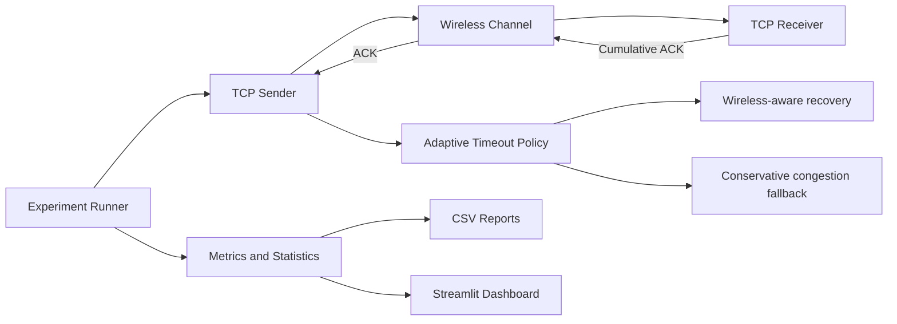

# Wireless TCP Simulator

### From packet loss → adaptive recovery → measurable performance

A discrete-event simulation platform for studying TCP behaviour over unreliable wireless links.

**An explainable, rule-based recovery approach with conservative congestion handling.**

[Overview](#wireless-tcp-simulator) · [Architecture](#architecture-at-a-glance) · [How it works](#adaptive-recovery-policy) · [Experiments](#experimental-results) · [Run locally](#windows-setup) · [Documentation](#project-documentation)

---

# Wireless TCP Simulator

A Python discrete-event simulator for studying TCP behavior over unreliable wireless links. It compares a simplified TCP NewReno baseline with a conservative wireless-aware timeout recovery policy.

> **Research boundary:** This is an educational discrete-event model, not a modified operating-system TCP stack or a complete standards-conformance implementation. Results must be measured; no performance improvement is claimed in advance.

## Project status — Milestone 12 complete

Implemented:
- Deterministic discrete-event scheduler with cancellable events.
- DATA and cumulative ACK packet model.
- Wireless channel with configurable independent random packet loss, propagation delay, and an optional two-state Gilbert–Elliott burst-loss model.
- Optional packet-keyed shared loss trace for repeatable cross-algorithm comparisons.
- Multi-seed experiment runner with paired statistics for independent packet-keyed loss and Welch independent-sample analysis for burst-loss experiments.
- Configurable Gilbert–Elliott state transition/loss probabilities with measured loss rate and GOOD/BAD transmission-state share recorded per run.
- Shared time-indexed Gilbert–Elliott traces: each scenario with the same seed observes the same channel state at each virtual-time slot; loss draws are deterministically keyed by time slot, direction, sequence, and attempt.
- Timestamped per-transmission records containing virtual time, packet direction, sequence number, attempt number, channel state, and drop outcome.
- Receiver with out-of-order buffering and cumulative ACK generation.
- Sliding-window sender with a single retransmission timer for the oldest unacknowledged packet.
- Congestion window (cwnd), slow start, congestion avoidance, duplicate ACK counting, fast retransmit, fast recovery, and timeout response.
- Rule-based adaptive timeout recovery using observable/simulated signal strength and queueing-delay inputs, with explicit priority for congestion evidence.
- Finite-value validation for signal, queue-delay, and policy-threshold inputs; boundary tests at and immediately below the congestion threshold.
- Configurable signal-strength and queue-delay values plus policy thresholds in the multi-seed experiment runner.
- Congestion-window history, event log, and automated tests.
- Interactive Streamlit + Plotly dashboard for scenario comparison, metrics, congestion-window history, and recovery decisions.
- Step-by-step packet-flow animation built from the simulator's recorded DATA/ACK channel events, including visible packet drops and reverse-direction ACK delivery.

The congestion window is expressed in packet/MSS units. The model uses a fixed RTO and does not yet model RTT estimation, delayed ACKs, receiver-advertised windows, explicit packet queueing, detailed RF fading, or all TCP NewReno edge cases.

## Requirements

- Python 3.10+
- Windows, macOS, or Linux

## Windows setup

~~~powershell
git clone https://github.com/axel4u/Wireless-TCP-Simulator.git
cd Wireless-TCP-Simulator
python -m venv .venv
.\.venv\Scripts\python.exe -m pip install -r requirements.txt
.\.venv\Scripts\python.exe main.py
dashboard.py
.\.venv\Scripts\python.exe -m pytest -q
~~~

In VS Code, select the project interpreter at .venv\\Scripts\\python.exe, configure pytest from the Testing panel, and use Source Control → Pull to receive updates.

## Fair comparison mode

Use `--loss-mode shared` in both runs. The shared trace keys each loss decision by packet direction, sequence number, and transmission-attempt number. Thus the same corresponding DATA/ACK attempt receives the same drop outcome in separate runs with the same seed and loss probability, regardless of transmission ordering.

Baseline:

~~~powershell
python main.py --packets 30 --loss 0.10 --loss-mode shared --seed 7
~~~

Adaptive wireless-aware run:

~~~powershell
python main.py --packets 30 --loss 0.10 --loss-mode shared --adaptive --signal-db -95 --queue-delay-ms 5 --seed 7
~~~

Adaptive congestion-fallback run:

~~~powershell
python main.py --packets 30 --loss 0.10 --loss-mode shared --adaptive --signal-db -95 --queue-delay-ms 80 --seed 7
~~~

The shared trace is deterministic and packet-keyed; it is not a time-varying physical channel model. Because ACK sequence numbers can be generated a different number of times by different sender behaviors, the comparison aligns corresponding attempts, not necessarily every event in chronological order. For stronger statistical claims, run multiple seeds and report averages and variability.

## Random mode

The default `--loss-mode random` retains the original sequential random-number generator behavior:

~~~powershell
python main.py --packets 30 --loss 0.10 --seed 7
~~~

## Wireless channel models (Milestone 9)

The independent-loss model samples each transmission attempt separately. The optional Gilbert–Elliott model switches between GOOD and BAD channel states: each state has its own packet-loss probability, and transition probabilities control how long the channel tends to remain in each state. This creates temporally correlated losses and makes consecutive packet drops possible. The model records the number of attempts in each state, total drops, and measured loss rate. Its initial state is GOOD. It is a simplified statistical channel abstraction, not a measured RF/fading model.

The dashboard lets you select independent random loss or burst loss and choose either a shared time-indexed trace or the original sequential stream. For burst mode, it exposes the four Gilbert–Elliott probabilities and reports measured loss rate plus GOOD/BAD transmission-state share. The multi-seed runner supports `--channel-model burst --loss-mode random`, `--burst-trace-mode shared-time|sequential`, and the four probability arguments `--good-to-bad`, `--bad-to-good`, `--good-loss`, and `--bad-loss`. Shared-time mode uses the same deterministic GOOD/BAD state timeline at each virtual-time slot for all scenarios with the same seed, and therefore supports paired per-seed analysis under a common channel environment. The loss decision is keyed by time slot, direction, sequence, and attempt; packets do not necessarily align one-to-one across algorithms. Sequential mode retains independent per-scenario random streams and uses Welch independent-sample comparisons.

## Architecture at a glance

## Adaptive recovery policy

The policy evaluates simulated signal strength and queue delay when a retransmission timeout occurs.

| Condition | Classification | Recovery |
|---|---|---|
| Queue delay ≥ 40 ms | Likely congestion | Standard TCP timeout response |
| Queue delay < 40 ms and signal ≤ -80 dBm | Likely wireless | Retransmit without timeout congestion-window reduction |
| Otherwise | Uncertain | Standard TCP timeout response |

Congestion evidence always takes priority over weak signal strength. The policy is rule-based, not machine-learning-based. Duplicate-ACK fast recovery remains the NewReno-style baseline behaviour.

## Adaptive policy assumptions

The adaptive inputs are explicit simulator measurements, not live Wi-Fi telemetry. The channel's hidden loss decision is not exposed to the policy. In this prototype, classification is applied to timeout recovery; duplicate-ACK fast recovery remains the conservative NewReno behavior. High queueing delay takes priority as congestion evidence; uncertain conditions use the standard timeout response.

## Project layout

~~~text
simulator/
  adaptive_policy.py
  channel.py
  congestion_control.py
  event_scheduler.py
  loss_trace.py
  paired_statistics.py
  packet.py
  receiver.py
  sender.py
tests/
  test_adaptive_policy.py
  test_adaptive_sender.py
  test_channel.py
  test_loss_trace.py
  test_paired_statistics.py
  test_sender.py
main.py
dashboard.py
~~~

## Experimental results

The following results are from the reported 100-seed shared time-indexed Gilbert–Elliott burst-loss experiment. All 100 runs completed successfully in each scenario.

| Metric | NewReno-style baseline | Adaptive wireless |
|---|---:|---:|
| Mean completion time | 758.500 ms | 632.000 ms |
| Mean goodput | 0.497 Mbps | 0.531 Mbps |
| Mean retransmissions | 3.010 | 2.700 |
| Mean timeouts | 2.810 | 2.300 |
| Mean packet drops | 4.670 | 4.380 |

**Paired statistical results (adaptive minus baseline):**

| Metric | Mean difference | 95% confidence interval | p-value |
|---|---:|---|---:|
| Completion time | -126.5 ms | [-191.173, -61.827] | 0.000188 |
| Goodput | +0.034 Mbps | [+0.018, +0.050] | 0.000045 |
| Timeouts | -0.510 | [-0.951, -0.069] | 0.023858 |

These are simulator-specific results, not measurements from a physical Wi-Fi network. Goodput and completion time are mathematically related and should not be treated as independent evidence. See the detailed experimental section below for configurations, sensitivity results, and limitations.

## Project documentation

- [Final report figures and architecture diagrams](docs/FINAL_REPORT_FIGURES.md)
- [Literature review and IEEE references](docs/LITERATURE_REVIEW_AND_REFERENCES.md)

## Multi-seed experimental evaluation

The experiment runner executes the baseline, adaptive wireless, and adaptive congestion-fallback scenarios across a consecutive range of seeds. It uses shared packet-keyed loss by default and writes one detailed CSV row per scenario/seed plus a summary CSV.

Run the recommended 30-seed evaluation from the repository root:

~~~powershell
python run_experiments.py
~~~

Useful options:

~~~powershell
python run_experiments.py --seeds 50 --start-seed 1 --packets 30 --loss 0.10
python run_experiments.py --seeds 10 --start-seed 100 --loss-mode random
python run_experiments.py --seeds 30 --output-dir results/low-loss --loss 0.05
python run_experiments.py --seeds 100 --channel-model burst --loss-mode random --burst-trace-mode shared-time --good-to-bad 0.02 --bad-to-good 0.25 --good-loss 0.01 --bad-loss 0.80 --output-dir results/burst-shared-time
~~~

Output files (created automatically):

- `results/multi_seed_results.csv` — detailed result for every scenario and seed.
- `results/multi_seed_summary.csv` — per-scenario delivery success rate, mean, and sample standard deviation.
- `results/paired_seed_comparisons.csv` — baseline and comparison metrics plus per-seed deltas.
- `results/paired_statistical_report.csv` — paired mean/median deltas, 95% confidence intervals, paired t-test p-values, and exact two-sided sign-test p-values (independent-loss mode only).
- `results/independent_sample_report.csv` — Welch independent-sample mean differences, 95% confidence intervals, and two-sided p-values (sequential burst mode only).

Metrics include delivered packets, unique ACKs, completion time, goodput, retransmissions, timeouts, drops, final cwnd/ssthresh, and recovery-decision counts. Goodput is calculated as successfully delivered application payload bits divided by elapsed simulation time. Means and standard deviations for performance metrics use successful runs; delivery success rate is reported separately. Failed runs remain visible in the detailed CSV with an error message.

The default scenarios use -95 dBm with 5 ms queue delay for the wireless-aware case, and -95 dBm with 80 ms queue delay for congestion fallback. These are controlled simulated inputs, not live telemetry. Milestone 11 exposes `--signal-db`, `--wireless-queue-delay-ms`, `--congestion-queue-delay-ms`, `--congestion-queue-threshold-ms`, and `--weak-signal-threshold-db` so the policy can be stress-tested at boundary and alternate operating points. Each detailed burst result row includes a serialized `channel_transmission_records` field with the time, packet type, sequence, attempt, state, and drop decision for every transmission.

### Paired statistical analysis

The runner matches baseline and comparison runs by seed. It writes one paired row per seed and comparison, with each delta defined as comparison minus baseline. Performance comparisons use only matched seeds where both runs completed successfully; the number of matched successful pairs is recorded. Completion time, retransmissions, timeouts, and packet drops treat a negative delta as favorable; goodput treats a positive delta as favorable. Congestion-window and threshold deltas are descriptive and are not labeled as universally better or worse.

The report includes a two-sided paired t-test and 95% t-based confidence interval for the mean paired difference, plus a two-sided exact sign test that counts non-tied wins and losses. These calculations use the Python standard library; no extra statistical package is required. The sign test is a useful distribution-light cross-check, while the paired t-test and confidence interval rely on the usual assumptions about independent seed-level pairs and the sampling distribution of their mean. The shared trace is packet-keyed rather than fully time-aligned, so statistical significance does not remove the simulator's modeling limitations. Do not interpret a p-value as proof of real-world network performance.

**Interpretation:** the shared loss trace aligns corresponding direction/sequence/attempt keys; it is not a fully time-aligned physical channel trace. Treat the output as evidence within this simulator's assumptions, not as proof of real-network performance. Report the seed range, configuration, success rate, means, and variability.

## Interactive dashboard and packet-flow animation (Milestones 7–8)

Install the dashboard dependencies:

~~~powershell
python -m pip install -r requirements.txt
~~~

Launch the app from the repository root:

~~~powershell
python -m streamlit run dashboard.py
~~~

The dashboard compares the NewReno baseline, adaptive wireless recovery, and adaptive congestion-fallback scenarios using the same seed and packet-keyed shared-loss mode. It provides configurable packet count, loss probability, propagation delay, RTO, seed, signal strength, and queueing delay; metric summaries; Plotly completion-time and goodput charts; congestion-window history; and adaptive recovery-decision details. The packet-flow section animates the recorded DATA and ACK events across sender, wireless channel, and receiver, with dropped packets marked at the channel and a step slider plus event-log table. This is a visualization of the completed discrete-event run, not a live socket-level packet capture.

The dashboard's signal-strength and queue-delay values are simulated inputs, not live Wi-Fi measurements. Its congestion-evidence control scenario enforces at least 40 ms queue delay so that the congestion fallback branch can be inspected even when the wireless queue-delay slider is lower. The shared loss trace remains packet-keyed rather than a fully time-aligned physical channel trace.

## Planned milestones

1. Packet and channel foundation — complete.
2. Reliable delivery with RTO and cumulative ACKs — complete.
3. TCP NewReno baseline — implemented.
4. Wireless-aware timeout recovery — initial policy implemented.
5. Shared-loss experiment foundation — implemented.
6. Multi-seed experimental evaluation and CSV reporting — implemented.
6.1 Paired per-seed statistical evaluation — implemented.
7. Streamlit + Plotly dashboard — implemented.
8. Interactive packet-level flow visualization — initial version implemented.
9. Gilbert–Elliott burst-loss channel model — initial implementation added.
10. Shared time-indexed burst trace and paired experiment evaluation — implemented.
11. Robustness and congestion-safety validation — implemented and locally verified.
12. Signal-strength / queue-delay sensitivity sweep — implemented and executed.
13. Final report integration and optional comparison with an established network simulator if required.

## Experimental integrity

- Use the shared packet-keyed loss mode for cross-algorithm comparisons.
- Run multiple seeds and report averages and variability before making performance claims.
- Do not leak the simulator's hidden ground-truth loss cause into the policy.
- Treat congestion as real and preserve a conservative fallback.
- Report goodput, delay/RTT, retransmissions, recovery time, and fairness as appropriate.
- Document assumptions and limitations alongside every result.

## License

This repository currently has no license file.

## Burst-channel measurement and statistics

For burst runs, the CSV records the four configured Gilbert–Elliott probabilities, total transmission attempts, measured loss rate, GOOD/BAD state attempt counts, and state occupancy percentages. The dashboard exposes the same four parameters and reports observed channel statistics. The nominal `--loss` argument applies only to independent-loss mode and is not used by Gilbert–Elliott mode.

Because each algorithm's behavior can consume a different number of sequential random draws, burst-mode runs are not paired by seed. The runner therefore omits paired CSVs and writes an independent-sample Welch report. This report compares successful runs from independent scenario groups; delivery success rates remain a separate outcome. Welch inference assumes independent seed-level observations and should be treated as model-specific evidence, not real-network validation.

### Shared time-indexed burst trace (Milestone 10)

Use the shared-time trace for the primary burst-channel comparison:

~~~powershell
python run_experiments.py --seeds 100 --channel-model burst --loss-mode random --burst-trace-mode shared-time --good-to-bad 0.02 --bad-to-good 0.25 --good-loss 0.01 --bad-loss 0.80 --output-dir results/burst-shared-time
~~~

For a given seed, each scenario constructs the same deterministic channel-state timeline indexed by 1 ms virtual-time slots. The channel state is therefore a function of simulation time, not the number of transmissions made by a scenario. A loss draw is then deterministic for the tuple (seed, time slot, direction, sequence number, attempt number), using the loss probability of the state at that time. This gives paired runs a common time-indexed wireless environment while allowing their packet schedules and retransmission decisions to differ naturally.

The detailed CSV includes `channel_transmission_records`, a serialized list recording each transmission's virtual time, packet direction, sequence, attempt, GOOD/BAD state, and drop result. State-share metrics describe the states sampled at transmission attempts, not total wall-clock occupancy. The shared-time trace is still a statistical abstraction, not a physical RF channel or a fully synchronized packet-by-packet replay. Paired inference is across independent seeds under common per-seed channel timelines; report the assumptions and confidence intervals with results.

## Robustness and congestion-safety validation (Milestone 11)

The policy applies a conservative decision order:
1. If queue delay is at or above the configured congestion threshold, classify the loss as likely congestion, even when signal strength is very weak.
2. Only when queue delay is below the threshold can weak signal classify the condition as likely wireless.
3. Otherwise classify the evidence as uncertain and use the standard timeout fallback.

The experiment runner exposes these simulated inputs and thresholds. Example boundary-oriented configuration:

~~~powershell
python run_experiments.py --seeds 30 --channel-model burst --loss-mode random --burst-trace-mode shared-time --signal-db -95 --wireless-queue-delay-ms 39 --congestion-queue-delay-ms 40 --congestion-queue-threshold-ms 40 --weak-signal-threshold-db -80 --output-dir results/robustness-boundary
~~~

The tests cover the exact congestion threshold, a value immediately below it, weak-signal-plus-high-queue priority, sender congestion-window reduction on the congestion fallback, and rejection of non-finite measurements or thresholds. A passing test suite verifies implementation behavior; it does not by itself prove that the simulated thresholds are suitable for real Wi-Fi. Threshold calibration and validation against measured telemetry remain future work.

## Parameter sensitivity sweep (Milestone 12)

Run the 3 x 3 signal-strength / queue-delay grid:

~~~powershell
python run_sensitivity.py --seeds 30 --signals=-79,-80,-81 --queue-delays=39,40,41 --congestion-queue-threshold-ms 40 --weak-signal-threshold-db -80 --output-dir results/sensitivity
~~~

The sweep runs a NewReno baseline and adaptive scenario for each grid point and seed, using the same shared time-indexed Gilbert–Elliott channel trace for each pair. It writes:
- `sensitivity_detailed.csv`: individual baseline/adaptive runs and observed transmission records.
- `sensitivity_summary.csv`: success rate, means, and standard deviations for each grid point and scenario.
- `sensitivity_paired_report.csv`: paired deltas, 95% confidence intervals, paired t-test and sign-test results per grid point.

Expected decision boundaries with thresholds -80 dBm and 40 ms:
- queue delay below 40 ms and signal at or below -80 dBm: WIRELESS;
- queue delay below 40 ms and signal above -80 dBm: UNCERTAIN;
- queue delay at or above 40 ms: CONGESTION regardless of signal.

This is a sensitivity study of simulated inputs, not calibration against measured Wi-Fi telemetry. The baseline is rerun at each grid point so each comparison uses the same seed and channel timeline.

## Consolidated experimental results (Milestones 10–12)

This section records the latest reported multi-seed results for reproducibility. These are results from the simulator's shared time-indexed Gilbert–Elliott channel abstraction; they are not measurements from a physical Wi-Fi network.

### Experiment A: 100-seed shared-time burst-loss comparison

Configuration:
- 100 seeds; 3 scenarios; 300 simulation runs.
- Gilbert–Elliott parameters: GOOD→BAD 0.02, BAD→GOOD 0.25, GOOD-state loss 0.01, BAD-state loss 0.80.
- Shared time-indexed trace; 30 packets per run.
- All three scenarios completed 100/100 runs.

| Metric | NewReno-style baseline | Adaptive wireless |
|---|---:|---:|
| Mean completion time | 758.500 ms | 632.000 ms |
| Mean goodput | 0.497 Mbps | 0.531 Mbps |
| Mean retransmissions | 3.010 | 2.700 |
| Mean timeouts | 2.810 | 2.300 |
| Mean packet drops | 4.670 | 4.380 |
| Mean final cwnd | 6.590 | 8.936 |

Paired differences (adaptive wireless minus baseline):

| Metric | Mean difference | 95% confidence interval | Paired t-test p-value |
|---|---:|---|---:|
| Completion time | -126.5 ms | [-191.173, -61.827] | 0.000188 |
| Goodput | +0.034 Mbps | [+0.018, +0.050] | 0.000045 |
| Timeouts | -0.510 | [-0.951, -0.069] | 0.023858 |

For this configuration, completion time, goodput, and timeout differences were statistically significant at the 5% level. Goodput and completion time are mathematically related when delivered payload is fixed, so they are not independent evidence. The result supports a simulator-specific finding, not a real-Wi-Fi performance claim.

### Experiment B: 30-seed robustness / congestion-safety comparison

Configuration:
- 30 seeds; 3 scenarios; 90 simulation runs.
- Shared time-indexed Gilbert–Elliott trace.
- Adaptive wireless input: weak signal and 39 ms queue delay.
- Adaptive congestion input: weak signal and 40 ms queue delay.
- All scenarios completed 30/30 runs.

| Metric | Baseline | Adaptive wireless |
|---|---:|---:|
| Mean completion time | 728.333 ms | 593.333 ms |
| Mean goodput | 0.498 Mbps | 0.544 Mbps |
| Mean retransmissions | 2.600 | 2.300 |
| Mean timeouts | 2.567 | 1.967 |

Paired analysis for the wireless condition:
- Completion time: -135 ms; 95% CI [-243.993, -26.007]; p=0.016966.
- Goodput: +0.0464 Mbps; 95% CI [+0.0115, +0.0813]; p=0.010875.
- Retransmissions: -0.30; p=0.402130 (not statistically significant).
- Timeouts: -0.60; p=0.080067 (not statistically significant).

The congestion-fallback scenario matched the baseline. This confirms the tested policy branch retained standard congestion handling at the configured queue-delay threshold.

### Experiment C: 3 × 3 signal / queue-delay sensitivity sweep

Reproduction command:

~~~powershell
python run_sensitivity.py --seeds 30 --signals=-79,-80,-81 --queue-delays=39,40,41 --congestion-queue-threshold-ms 40 --weak-signal-threshold-db -80 --output-dir results/sensitivity
~~~

The sweep executed 540 simulations: 9 input combinations × 30 seeds × 2 scenarios. All 30 runs per scenario/grid point completed successfully.

Policy classification:

| Queue delay | -79 dBm | -80 dBm | -81 dBm |
|---|---|---|---|
| 39 ms | Uncertain | Likely wireless | Likely wireless |
| 40 ms | Likely congestion | Likely congestion | Likely congestion |
| 41 ms | Likely congestion | Likely congestion | Likely congestion |

At the two wireless-classified grid points (-80 dBm / 39 ms and -81 dBm / 39 ms), the adaptive means were 593.333 ms completion time and 0.544126 Mbps goodput, compared with baseline means of 728.333 ms and 0.497722 Mbps. Paired p-values were 0.016966 for completion time and 0.010875 for goodput. The two grid points activate the same threshold-based policy branch and therefore are not independent replications.

At the uncertain point (-79 dBm / 39 ms) and all congestion points (queue delay 40 or 41 ms), adaptive results were identical to baseline. This demonstrates the configured classification and fallback behaviour, not that the chosen thresholds are universally optimal.

### Reproducibility commands

100-seed shared-time burst experiment:

~~~powershell
python run_experiments.py --seeds 100 --channel-model burst --loss-mode random --burst-trace-mode shared-time --good-to-bad 0.02 --bad-to-good 0.25 --good-loss 0.01 --bad-loss 0.80 --output-dir results/burst-shared-time
~~~

30-seed boundary experiment:

~~~powershell
python run_experiments.py --seeds 30 --channel-model burst --loss-mode random --burst-trace-mode shared-time --signal-db -95 --wireless-queue-delay-ms 39 --congestion-queue-delay-ms 40 --congestion-queue-threshold-ms 40 --weak-signal-threshold-db -80 --output-dir results/robustness-boundary
~~~

Sensitivity experiment:

~~~powershell
python run_sensitivity.py --seeds 30 --signals=-79,-80,-81 --queue-delays=39,40,41 --congestion-queue-threshold-ms 40 --weak-signal-threshold-db -80 --output-dir results/sensitivity
~~~

Run the local test suite after pulling repository changes:

~~~powershell
python -m pytest -q
~~~

### Interpretation and reporting cautions

- These results are specific to the simulator, its simplified NewReno-style implementation, selected parameters, and shared time-indexed channel abstraction.
- The signal and queue-delay inputs are simulated values, not live Wi-Fi telemetry.
- The adaptive classifier is rule-based; it is not a machine-learning model.
- Congestion evidence takes priority over weak signal; uncertain conditions use standard timeout recovery.
- The shared trace aligns channel state by virtual-time slot, but does not recreate a measured physical RF trace or guarantee identical packet schedules.
- Report seed counts, successful-run counts, configuration, variability, confidence intervals, and limitations alongside performance results.
- Do not describe the experiments as proof of real-world Wi-Fi improvement. Physical-network or NS-3 validation remains future work.
