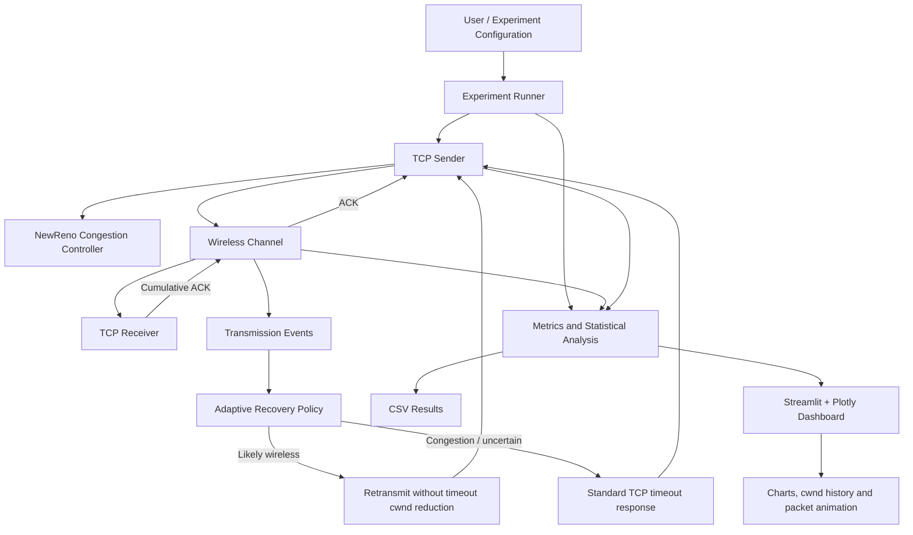
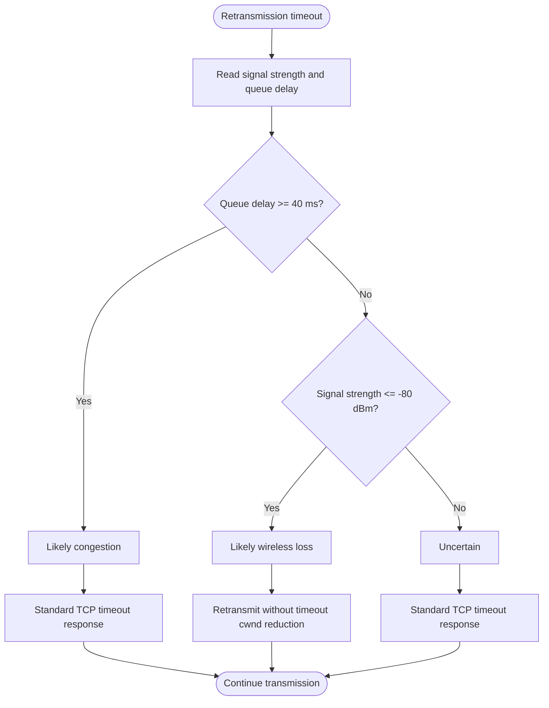
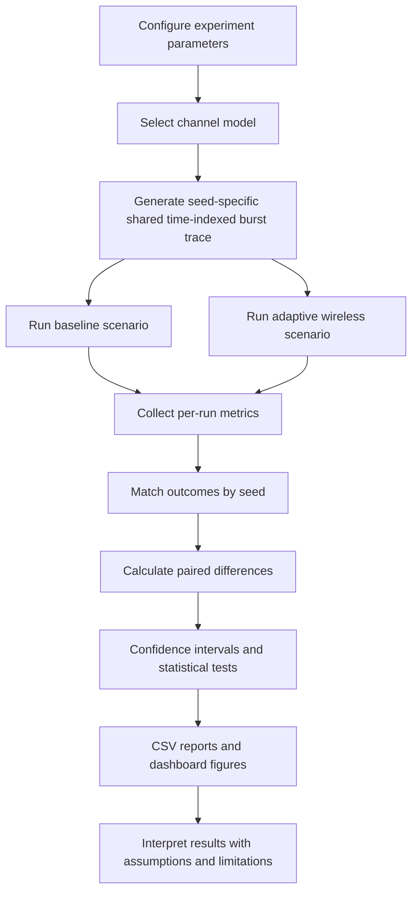

# Final Report Figures — Wireless TCP Simulator

This document contains report-ready figure definitions and captions for the architecture and evaluation chapters. The diagrams describe the implemented simulator; they do not represent a modified operating-system TCP stack or live Wi-Fi telemetry.

## Figure 1. Overall system architecture

**Caption:** Overall architecture of the Wireless TCP Simulator and its wireless-aware adaptive timeout recovery mechanism.

**Explanation:** The sender transmits DATA packets through the simulated wireless channel. The receiver buffers out-of-order data and generates cumulative acknowledgements. When a timeout occurs, the adaptive policy evaluates the configured signal-strength and queue-delay inputs. It selects wireless-aware retransmission only when queue delay is below the congestion threshold and signal strength is weak. Congestion and uncertain conditions use the standard timeout response. The experiment runner collects metrics for CSV reporting and dashboard visualization.

## Figure 2. Adaptive recovery decision flowchart

**Caption:** Decision process used by the rule-based adaptive recovery policy.

**Explanation:** Congestion evidence takes priority over weak signal strength. The policy is invoked for timeout recovery; duplicate-ACK fast recovery remains the NewReno-style baseline behaviour. The values shown are the project's default thresholds and are configurable in the experiment runner.

## Figure 3. Experimental methodology

**Caption:** Experimental workflow for controlled comparison of baseline and adaptive recovery.

**Explanation:** For each seed, baseline and adaptive scenarios use a common deterministic time-indexed channel-state timeline. Their packet schedules may differ, so the trace does not imply identical packet-by-packet transmissions. Paired statistical analysis compares seed-level outcomes under the common simulated channel timeline.

## Figure 4. Completion-time comparison

**Data source:** 100-seed shared time-indexed Gilbert–Elliott burst-loss experiment.

| Scenario | Mean completion time |
|---|---:|
| NewReno-style baseline | 758.500 ms |
| Adaptive wireless | 632.000 ms |

**Caption:** Mean simulated completion time across 100 seeds. Lower values indicate faster completion in this simulator configuration.

## Figure 5. Goodput comparison

**Data source:** Same 100-seed experiment.

| Scenario | Mean goodput |
|---|---:|
| NewReno-style baseline | 0.497 Mbps |
| Adaptive wireless | 0.531 Mbps |

**Caption:** Mean simulated goodput across 100 seeds. Goodput is successfully delivered application payload divided by elapsed simulation time.

## Figure 6. Timeout comparison

**Data source:** Same 100-seed experiment.

| Scenario | Mean timeout events |
|---|---:|
| NewReno-style baseline | 2.810 |
| Adaptive wireless | 2.300 |

**Caption:** Mean number of retransmission timeout events across 100 seeds.

## Figure 7. Signal-strength and queue-delay sensitivity grid

| Queue delay | -79 dBm | -80 dBm | -81 dBm |
|---|---|---|---|
| 39 ms | Uncertain | Likely wireless | Likely wireless |
| 40 ms | Likely congestion | Likely congestion | Likely congestion |
| 41 ms | Likely congestion | Likely congestion | Likely congestion |

**Caption:** Policy classification for the 3 × 3 sensitivity experiment using a -80 dBm weak-signal threshold and a 40 ms congestion queue-delay threshold.

## Statistical results to accompany Figures 4–6

| Metric | Adaptive minus baseline | 95% confidence interval | Paired t-test p-value |
|---|---:|---|---:|
| Completion time | -126.5 ms | [-191.173, -61.827] | 0.000188 |
| Goodput | +0.034 Mbps | [+0.018, +0.050] | 0.000045 |
| Timeouts | -0.510 | [-0.951, -0.069] | 0.023858 |

The differences above were statistically significant at the 5% level in this 100-seed experiment. Goodput and completion time are mathematically related when the successfully delivered payload is fixed; they should not be presented as independent evidence. P-values are specific to this configuration and do not establish real-world Wi-Fi performance.

## Figure and result limitations

- The system is a Python discrete-event simulation, not a modified OS TCP stack.
- Signal strength and queue delay are supplied simulated inputs, not live Wi-Fi measurements.
- The adaptive policy is rule-based, not machine learning.
- The Gilbert–Elliott channel is a statistical burst-loss abstraction, not a physical RF propagation model.
- Shared time-indexed traces align channel state by virtual time, but do not reproduce a measured RF trace or identical packet schedules.
- The NewReno-style sender is simplified and does not implement every TCP standard detail.
- Results must be reported with seed count, success rate, configuration, variability, confidence intervals, and limitations.
